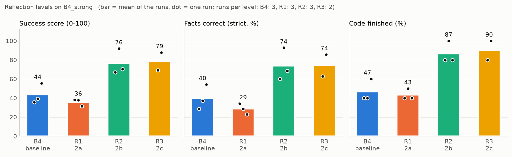
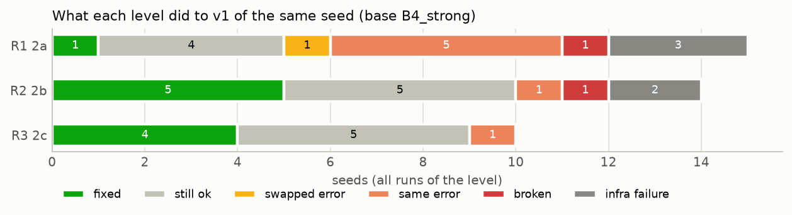
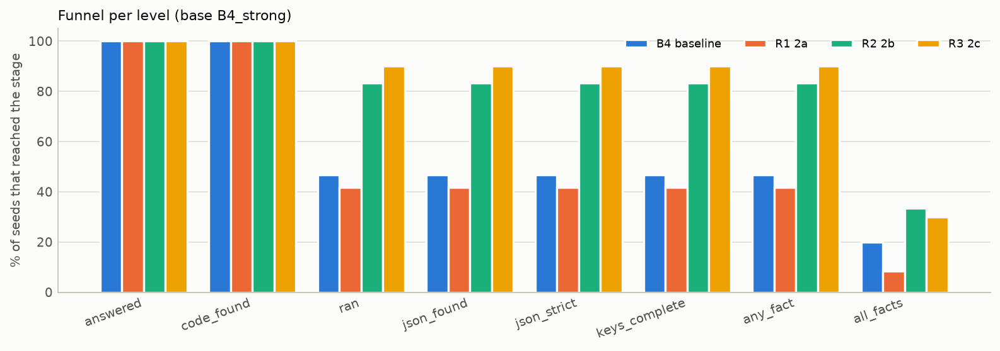
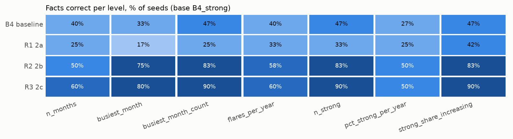
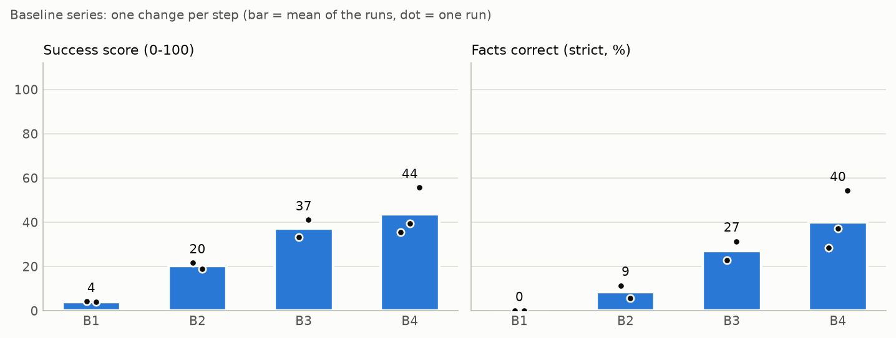
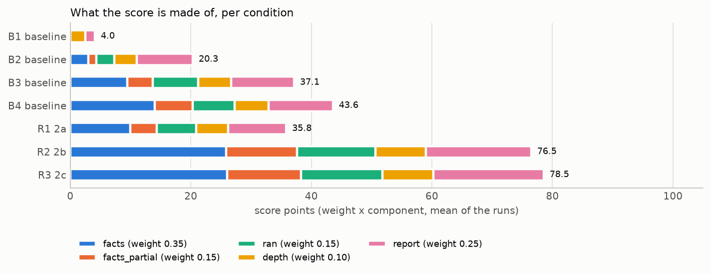
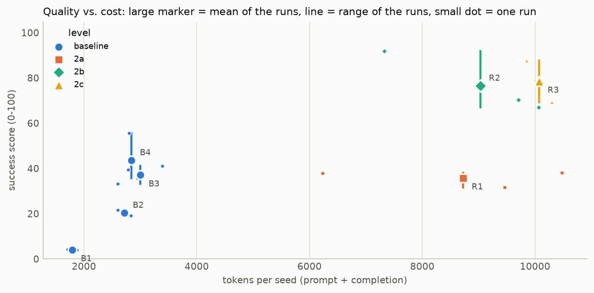

# Performance log

Generated by `python analyze.py` on 2026-11-26 20:29. **Do not edit by hand** (it is rebuilt from `experiments/*/`). One row per experiment; every experiment runs the same seeds.

How to read: **depth** = how many funnel stages in a row a run passed (0-8); a crash early gives a low depth, a wrong number at the end still gives a high one. **facts** = share of the 7 requested values that match `ground_truth.json`. **Δ** = difference of the mean against the reference experiment named in the cell.

Shims = runner helpers (`SHIM` in `src/runner.py`: `display`, numpy-safe JSON).

Funnel stages: `answered` → `code_found` → `ran` → `json_found` → `json_strict` → `keys_complete` → `any_fact` → `all_facts`

## 0. Per condition: success score and its parts (two-stage mean over runs)

**Score** (0-100) = 100 x (0.35 x facts + 0.15 x facts_partial + 0.15 x ran + 0.10 x depth + 0.25 x report); every part is 0-1 per seed (facts = share of the 7 facts right, strict or with partial credit for the years; ran = code finished; depth = funnel stages passed / 8; report = report quality). Weights in `src/metrics.py`. Cost is not part of the score.
Stage 1: mean over the seeds of a run. Stage 2: mean of the run means (every run weighs the same). **sd runs** = spread between the run means (needs 2+ runs); **sd seeds** = mean spread inside a run. **Δ (paired)** = every reflection run minus the base run it reflected on, averaged over the runs. Infrastructure failures (Docker down, LLM timeout) are left out and counted.

| Condition | Level | Runs | Score | sd runs | sd seeds | Δ score (paired) | Facts % | Facts partial % | Ran % | Depth % | Report | Tokens / seed | Δ score per 1k extra tokens |
|---|---|---|---|---|---|---|---|---|---|---|---|---|---|
| B1_original_prompt | baseline | vanessa_1, jan_1 | **4.0** | 0.1 | 0.6 | – | 0.0 | 0.0 | 0.0 | 25.0 | 6.2 | 1,796 | – |
| B2_schema | baseline | vanessa_1, jan_1 | **20.3** | 1.3 | 20.5 | – | 8.6 | 8.6 | 20.0 | 37.5 | 37.1 | 2,717 | – |
| B3_shims | baseline | vanessa_1, jan_1 | **37.1** | 3.9 | 30.7 | – | 27.1 | 28.1 | 50.0 | 55.0 | 41.6 | 2,997 | – |
| B4_strong | baseline | vanessa_1, mischa_1, jan_1 | **43.6** | 8.7 | 39.6 | – | 40.0 | 41.9 | 46.7 | 56.7 | 42.5 | 2,842 | – |
| R1_2a | 2a | vanessa_1, mischa_1, jan_1 (+3 infra) | **35.8** | 3.0 | 35.4 | -7.8 | 28.6 | 29.2 | 43.3 | 52.9 | 38.5 | 8,727 | -1.32 |
| R2_2b | 2b | vanessa_1, mischa_1, jan_1 (+2 infra) | **76.5** | 11.0 | 23.9 | +32.9 | 73.8 | 78.9 | 86.7 | 83.8 | 69.7 | 9,030 | +5.32 |
| R3_2c | 2c | vanessa_1, jan_1 | **78.5** | 9.3 | 20.8 | +32.9 | 74.3 | 81.9 | 90.0 | 85.0 | 73.0 | 10,072 | +4.57 |

### 0b. Score of every run (stage 1)

| Run | Level | Base run | Score ± sd seeds | Δ score vs. base run | facts | facts_partial | ran | depth | report | Transitions vs. v1 |
|---|---|---|---|---|---|---|---|---|---|---|
| B1_original_prompt/vanessa_1 | baseline | – | 4.2 ± 0.7 | – | 0.0 | 0.0 | 0.0 | 25.0 | 6.6 | – |
| B2_schema/vanessa_1 | baseline | – | 21.6 ± 23.9 | – | 11.4 | 11.4 | 20.0 | 37.5 | 36.5 | – |
| B3_shims/vanessa_1 | baseline | – | 33.2 ± 30.0 | – | 22.8 | 24.8 | 40.0 | 50.0 | 42.0 | – |
| B4_strong/vanessa_1 | baseline | – | 35.6 ± 36.5 | – | 28.6 | 34.3 | 40.0 | 50.0 | 37.9 | – |
| R1_2a/vanessa_1 | 2a | B4_strong/vanessa_1 | 38.1 ± 39.3 | +2.5 | 34.3 | 36.2 | 40.0 | 50.0 | 38.6 | same_error 2, still_ok 2, swapped 1 |
| R2_2b/vanessa_1 | 2b | B4_strong/vanessa_1 | 67.1 ± 31.8 | +31.4 | 60.0 | 70.5 | 80.0 | 77.5 | 63.0 | fixed 2, same_error 1, still_ok 2 |
| R3_2c/vanessa_1 | 2c | B4_strong/vanessa_1 | 69.2 ± 32.6 | +33.6 | 62.8 | 73.3 | 80.0 | 77.5 | 66.0 | fixed 2, same_error 1, still_ok 2 |
| B4_strong/mischa_1 | baseline | – | 39.4 ± 41.0 | – | 37.1 | 37.1 | 40.0 | 52.5 | 38.4 | – |
| R1_2a/mischa_1 | 2a | B4_strong/mischa_1 | 37.8 ± 32.1 | -1.6 | 28.6 | 28.6 | 50.0 | 56.2 | 41.8 | fixed 1, infra 3, same_error 1 |
| R2_2b/mischa_1 | 2b | B4_strong/mischa_1 | 91.9 ± 6.7 | +52.5 | 92.8 | 92.8 | 100.0 | 93.8 | 84.5 | fixed 1, infra 2, still_ok 1 |
| B4_strong/jan_1 | baseline | – | 55.6 ± 41.2 | – | 54.3 | 54.3 | 60.0 | 67.5 | 51.0 | – |
| R1_2a/jan_1 | 2a | B4_strong/jan_1 | 31.5 ± 34.9 | -24.1 | 22.9 | 22.9 | 40.0 | 52.5 | 35.3 | broken 1, same_error 2, still_ok 2 |
| R2_2b/jan_1 | 2b | B4_strong/jan_1 | 70.4 ± 33.1 | +14.8 | 68.6 | 73.3 | 80.0 | 80.0 | 61.6 | broken 1, fixed 2, still_ok 2 |
| R3_2c/jan_1 | 2c | B4_strong/jan_1 | 87.8 ± 9.0 | +32.2 | 85.7 | 90.5 | 100.0 | 92.5 | 80.0 | fixed 2, still_ok 3 |
| B1_original_prompt/jan_1 | baseline | – | 4.0 ± 0.4 | – | 0.0 | 0.0 | 0.0 | 25.0 | 5.8 | – |
| B2_schema/jan_1 | baseline | – | 19.0 ± 17.1 | – | 5.7 | 5.7 | 20.0 | 37.5 | 37.7 | – |
| B3_shims/jan_1 | baseline | – | 41.0 ± 31.4 | – | 31.4 | 31.4 | 60.0 | 60.0 | 41.2 | – |

## Figures

Built by `python analyze.py` into `results/figures/` (bar = mean of the runs, dot = one run).

## 1. Overview (one row per run)

| Run | Level | What changed | Ran | Depth (0-8) | Δ depth | Crash at | Facts % | Δ facts | Tokens / seed | LLM s / seed |
|---|---|---|---|---|---|---|---|---|---|---|
| B1_original_prompt/vanessa_1 | baseline | Start of new series: original prompt (E01), no schema, no shims | 0/5 | 2.0 ± 0.0 | – | 34 % of script | 0 ± 0 | – | 1,712 | 166 |
| B2_schema/vanessa_1 | baseline | B1 + schema in the prompt | 1/5 | 3.0 ± 2.0 | +1.0 vs B1/vanessa_1 | 70 % of script | 11 ± 23 | +11.4 vs B1/vanessa_1 | 2,603 | 86 |
| B3_shims/vanessa_1 | baseline | B2 + shims | 2/5 | 4.0 ± 2.4 | +1.0 vs B2/vanessa_1 | 61 % of script | 23 ± 28 | +11.4 vs B2/vanessa_1 | 2,603 | 74 |
| B4_strong/vanessa_1 | baseline | B3 + prompt_strong | 2/5 | 4.0 ± 2.4 | +0.0 vs B3/vanessa_1 | 24 % of script | 29 ± 36 | +5.7 vs B3/vanessa_1 | 2,952 | 133 |
| R1_2a/vanessa_1 | 2a | B4 + reflection 2a (own code only) | 2/5 | 4.0 ± 2.4 | +0.0 vs B4/vanessa_1 | 22 % of script | 34 ± 42 | +5.7 vs B4/vanessa_1 | 10,481 | 210 |
| R2_2b/vanessa_1 | 2b | B4 + reflection 2b (sees run output) | 4/5 | 6.2 ± 2.1 | +2.2 vs B4/vanessa_1 | 20 % of script | 60 ± 34 | +31.4 vs B4/vanessa_1 | 10,065 | 157 |
| R3_2c/vanessa_1 | 2c | B4 + reflection 2c (sees run output and fact check) | 4/5 | 6.2 ± 2.1 | +2.2 vs B4/vanessa_1 | 22 % of script | 63 ± 35 | +34.3 vs B4/vanessa_1 | 10,299 | 147 |
| B4_strong/mischa_1 | baseline | B3 + prompt_strong | 2/5 | 4.2 ± 2.7 | +0.2 vs B3/vanessa_1 | 36 % of script | 37 ± 46 | +14.3 vs B3/vanessa_1 | 2,779 | 330 |
| R1_2a/mischa_1 | 2a | B4 + reflection 2a (own code only) | 1/2 | 4.5 ± 2.5 | +0.3 vs B4/mischa_1 | 30 % of script | 29 ± 29 | -8.6 vs B4/mischa_1 | 6,235 | 869 |
| R2_2b/mischa_1 | 2b | B4 + reflection 2b (sees run output) | 2/2 | 7.5 ± 0.5 | +3.3 vs B4/mischa_1 | – | 93 ± 7 | +55.7 vs B4/mischa_1 | 7,324 | 823 |
| B4_strong/jan_1 | baseline | B3 + prompt_strong | 3/5 | 5.4 ± 2.8 | +1.4 vs B3/vanessa_1 | 25 % of script | 54 ± 46 | +31.4 vs B3/vanessa_1 | 2,795 | 46 |
| R1_2a/jan_1 | 2a | B4 + reflection 2a (own code only) | 2/5 | 4.2 ± 2.7 | -1.2 vs B4/jan_1 | 23 % of script | 23 ± 39 | -31.4 vs B4/jan_1 | 9,464 | 104 |
| R2_2b/jan_1 | 2b | B4 + reflection 2b (sees run output) | 4/5 | 6.4 ± 2.2 | +1.0 vs B4/jan_1 | 42 % of script | 69 ± 38 | +14.3 vs B4/jan_1 | 9,702 | 91 |
| R3_2c/jan_1 | 2c | B4 + reflection 2c (sees run output and fact check) | 5/5 | 7.4 ± 0.5 | +2.0 vs B4/jan_1 | – | 86 ± 16 | +31.4 vs B4/jan_1 | 9,844 | 89 |
| B1_original_prompt/jan_1 | baseline | Start of new series: original prompt (E01), no schema, no shims | 0/5 | 2.0 ± 0.0 | -3.4 vs B4/jan_1 | 19 % of script | 0 ± 0 | -54.3 vs B4/jan_1 | 1,879 | 49 |
| B2_schema/jan_1 | baseline | B1 + schema in the prompt | 1/5 | 3.0 ± 2.0 | +1.0 vs B1/jan_1 | 88 % of script | 6 ± 11 | +5.7 vs B1/jan_1 | 2,831 | 56 |
| B3_shims/jan_1 | baseline | B2 + shims | 3/5 | 4.8 ± 2.7 | +1.8 vs B2/jan_1 | 60 % of script | 31 ± 29 | +25.7 vs B2/jan_1 | 3,392 | 83 |

## 1b. Quality vs cost per reflection level

One table per baseline. Quality: runs that finished, funnel depth, facts, report quality (0-100). Cost: LLM calls, tokens and LLM seconds per seed (seconds depend on the machine and its power mode; compare tokens). **Δ facts per 1k extra tokens** = how many percentage points of facts a level gains for every 1,000 tokens it costs more than the baseline.

### Base B4_strong/vanessa_1

| Level | Exp | Ran | Depth | Facts % | Report | LLM calls | Tokens / seed | LLM s / seed | Δ facts | Δ tokens | Δ facts per 1k extra tokens |
|---|---|---|---|---|---|---|---|---|---|---|---|
| baseline | B4_strong/vanessa_1 | 2/5 | 4.0 | 29 | 38 | 1.0 | 2,952 | 133 | – | – | – |
| 2a | R1_2a/vanessa_1 | 2/5 | 4.0 | 34 | 39 | 2.0 | 10,481 | 210 | +5.7 | +7,529 | +0.76 |
| 2b | R2_2b/vanessa_1 | 4/5 | 6.2 | 60 | 63 | 2.0 | 10,065 | 157 | +31.4 | +7,113 | +4.42 |
| 2c | R3_2c/vanessa_1 | 4/5 | 6.2 | 63 | 66 | 2.0 | 10,299 | 147 | +34.3 | +7,347 | +4.67 |

### Base B4_strong/mischa_1

| Level | Exp | Ran | Depth | Facts % | Report | LLM calls | Tokens / seed | LLM s / seed | Δ facts | Δ tokens | Δ facts per 1k extra tokens |
|---|---|---|---|---|---|---|---|---|---|---|---|
| baseline | B4_strong/mischa_1 | 2/5 | 4.2 | 37 | 38 | 1.0 | 2,779 | 330 | – | – | – |
| 2a | R1_2a/mischa_1 | 1/2 | 4.5 | 29 | 42 | 1.8 | 6,235 | 869 | -8.6 | +3,456 | -2.49 |
| 2b | R2_2b/mischa_1 | 2/2 | 7.5 | 93 | 84 | 2.0 | 7,324 | 823 | +55.7 | +4,545 | +12.26 |

### Base B4_strong/jan_1

| Level | Exp | Ran | Depth | Facts % | Report | LLM calls | Tokens / seed | LLM s / seed | Δ facts | Δ tokens | Δ facts per 1k extra tokens |
|---|---|---|---|---|---|---|---|---|---|---|---|
| baseline | B4_strong/jan_1 | 3/5 | 5.4 | 54 | 51 | 1.0 | 2,795 | 46 | – | – | – |
| 2a | R1_2a/jan_1 | 2/5 | 4.2 | 23 | 35 | 2.0 | 9,464 | 104 | -31.4 | +6,669 | -4.71 |
| 2b | R2_2b/jan_1 | 4/5 | 6.4 | 69 | 62 | 2.0 | 9,702 | 91 | +14.3 | +6,907 | +2.07 |
| 2c | R3_2c/jan_1 | 5/5 | 7.4 | 86 | 80 | 2.0 | 9,844 | 89 | +31.4 | +7,049 | +4.46 |

## 2. Funnel (runs that reached each stage)

| Exp | answered | code_found | ran | json_found | json_strict | keys_complete | any_fact | all_facts |
|---|---|---|---|---|---|---|---|---|
| B1_original_prompt/vanessa_1 | 5/5 | 5/5 | 0/5 | 0/5 | 0/5 | 0/5 | 0/5 | 0/5 |
| B2_schema/vanessa_1 | 5/5 | 5/5 | 1/5 | 1/5 | 1/5 | 1/5 | 1/5 | 0/5 |
| B3_shims/vanessa_1 | 5/5 | 5/5 | 2/5 | 2/5 | 2/5 | 2/5 | 2/5 | 0/5 |
| B4_strong/vanessa_1 | 5/5 | 5/5 | 2/5 | 2/5 | 2/5 | 2/5 | 2/5 | 0/5 |
| R1_2a/vanessa_1 | 5/5 | 5/5 | 2/5 | 2/5 | 2/5 | 2/5 | 2/5 | 0/5 |
| R2_2b/vanessa_1 | 5/5 | 5/5 | 4/5 | 4/5 | 4/5 | 4/5 | 4/5 | 1/5 |
| R3_2c/vanessa_1 | 5/5 | 5/5 | 4/5 | 4/5 | 4/5 | 4/5 | 4/5 | 1/5 |
| B4_strong/mischa_1 | 5/5 | 5/5 | 2/5 | 2/5 | 2/5 | 2/5 | 2/5 | 1/5 |
| R1_2a/mischa_1 | 2/2 | 2/2 | 1/2 | 1/2 | 1/2 | 1/2 | 1/2 | 0/2 |
| R2_2b/mischa_1 | 2/2 | 2/2 | 2/2 | 2/2 | 2/2 | 2/2 | 2/2 | 1/2 |
| B4_strong/jan_1 | 5/5 | 5/5 | 3/5 | 3/5 | 3/5 | 3/5 | 3/5 | 2/5 |
| R1_2a/jan_1 | 5/5 | 5/5 | 2/5 | 2/5 | 2/5 | 2/5 | 2/5 | 1/5 |
| R2_2b/jan_1 | 5/5 | 5/5 | 4/5 | 4/5 | 4/5 | 4/5 | 4/5 | 2/5 |
| R3_2c/jan_1 | 5/5 | 5/5 | 5/5 | 5/5 | 5/5 | 5/5 | 5/5 | 2/5 |
| B1_original_prompt/jan_1 | 5/5 | 5/5 | 0/5 | 0/5 | 0/5 | 0/5 | 0/5 | 0/5 |
| B2_schema/jan_1 | 5/5 | 5/5 | 1/5 | 1/5 | 1/5 | 1/5 | 1/5 | 0/5 |
| B3_shims/jan_1 | 5/5 | 4/5 | 3/5 | 3/5 | 3/5 | 3/5 | 3/5 | 0/5 |

## 3. Where the runs fail (error category of the runs that crashed)

| Exp | Errors |
|---|---|
| B1_original_prompt/vanessa_1 | other:SyntaxError ×2, hallucinated_column ×1, other:ValueError ×1, date_parse ×1 |
| B2_schema/vanessa_1 | other:TypeError ×1, json_serialize ×1, api_misuse ×1, period_type ×1 |
| B3_shims/vanessa_1 | other:TypeError ×1, api_misuse ×1, period_type ×1 |
| B4_strong/vanessa_1 | datetime_type ×1, format_error ×1, date_parse ×1 |
| R1_2a/vanessa_1 | date_parse ×2, datetime_type ×1 |
| R2_2b/vanessa_1 | datetime_type ×1 |
| R3_2c/vanessa_1 | datetime_type ×1 |
| B4_strong/mischa_1 | format_error ×2, other:TypeError ×1 |
| R1_2a/mischa_1 | format_error ×1 |
| R2_2b/mischa_1 | – |
| B4_strong/jan_1 | format_error ×1, date_parse ×1 |
| R1_2a/jan_1 | format_error ×1, datetime_type ×1, date_parse ×1 |
| R2_2b/jan_1 | date_parse ×1 |
| R3_2c/jan_1 | – |
| B1_original_prompt/jan_1 | hallucinated_column ×2, date_parse ×1, other:SyntaxError ×1, internal_keyerror ×1 |
| B2_schema/jan_1 | json_serialize ×2, other:TypeError ×1, internal_keyerror ×1 |
| B3_shims/jan_1 | no_code ×1, internal_keyerror ×1 |

## 4. Accuracy per fact (runs with the correct value)

| Exp | n_months | busiest_month | busiest_month_count | flares_per_year | n_strong | pct_strong_per_year | strong_share_increasing |
|---|---|---|---|---|---|---|---|
| B1_original_prompt/vanessa_1 | 0/5 | 0/5 | 0/5 | 0/5 | 0/5 | 0/5 | 0/5 |
| B2_schema/vanessa_1 | 0/5 | 1/5 | 1/5 | 1/5 | 0/5 | 0/5 | 1/5 |
| B3_shims/vanessa_1 | 1/5 | 2/5 | 2/5 | 1/5 | 0/5 | 0/5 | 2/5 |
| B4_strong/vanessa_1 | 2/5 | 1/5 | 2/5 | 1/5 | 2/5 | 0/5 | 2/5 |
| R1_2a/vanessa_1 | 2/5 | 1/5 | 2/5 | 2/5 | 2/5 | 1/5 | 2/5 |
| R2_2b/vanessa_1 | 3/5 | 3/5 | 4/5 | 2/5 | 4/5 | 1/5 | 4/5 |
| R3_2c/vanessa_1 | 3/5 | 4/5 | 4/5 | 2/5 | 4/5 | 1/5 | 4/5 |
| B4_strong/mischa_1 | 1/5 | 2/5 | 2/5 | 2/5 | 2/5 | 2/5 | 2/5 |
| R1_2a/mischa_1 | 0/2 | 0/2 | 0/2 | 1/2 | 1/2 | 1/2 | 1/2 |
| R2_2b/mischa_1 | 1/2 | 2/2 | 2/2 | 2/2 | 2/2 | 2/2 | 2/2 |
| B4_strong/jan_1 | 3/5 | 2/5 | 3/5 | 3/5 | 3/5 | 2/5 | 3/5 |
| R1_2a/jan_1 | 1/5 | 1/5 | 1/5 | 1/5 | 1/5 | 1/5 | 2/5 |
| R2_2b/jan_1 | 2/5 | 4/5 | 4/5 | 3/5 | 4/5 | 3/5 | 4/5 |
| R3_2c/jan_1 | 3/5 | 4/5 | 5/5 | 4/5 | 5/5 | 4/5 | 5/5 |
| B1_original_prompt/jan_1 | 0/5 | 0/5 | 0/5 | 0/5 | 0/5 | 0/5 | 0/5 |
| B2_schema/jan_1 | 0/5 | 0/5 | 0/5 | 1/5 | 0/5 | 0/5 | 1/5 |
| B3_shims/jan_1 | 2/5 | 1/5 | 2/5 | 3/5 | 0/5 | 0/5 | 3/5 |

### 4b. Facts read from the report text (right / readable)

Used when the model prints no RESULTS_JSON: the same facts, read from the prose. `readable` = the text names the fact at all. flares_per_year and pct_strong_per_year cannot be read from prose.

| Exp | n_months | busiest_month | busiest_month_count | n_strong | strong_share_increasing |
|---|---|---|---|---|---|
| B1_original_prompt/vanessa_1 | 0/0 | 0/0 | 0/0 | 0/0 | 0/0 |
| B2_schema/vanessa_1 | 0/0 | 0/3 | 0/1 | 0/0 | 0/3 |
| B3_shims/vanessa_1 | 0/0 | 0/3 | 0/1 | 0/0 | 0/3 |
| B4_strong/vanessa_1 | 0/0 | 0/2 | 0/1 | 0/0 | 0/2 |
| R1_2a/vanessa_1 | 0/0 | 0/2 | 0/1 | 0/0 | 0/2 |
| R2_2b/vanessa_1 | 0/0 | 0/4 | 0/1 | 0/0 | 2/4 |
| R3_2c/vanessa_1 | 0/0 | 1/4 | 1/1 | 0/0 | 1/4 |
| B4_strong/mischa_1 | 0/0 | 0/2 | 0/0 | 0/0 | 0/2 |
| R1_2a/mischa_1 | 0/0 | 0/1 | 0/0 | 0/0 | 0/1 |
| R2_2b/mischa_1 | 0/0 | 1/2 | 1/1 | 0/0 | 1/2 |
| B4_strong/jan_1 | 0/0 | 0/3 | 0/0 | 0/0 | 0/3 |
| R1_2a/jan_1 | 0/0 | 0/2 | 0/1 | 0/0 | 0/2 |
| R2_2b/jan_1 | 0/0 | 0/4 | 0/1 | 0/0 | 0/4 |
| R3_2c/jan_1 | 0/0 | 0/5 | 0/1 | 0/0 | 2/5 |
| B1_original_prompt/jan_1 | 0/0 | 0/0 | 0/0 | 0/0 | 0/0 |
| B2_schema/jan_1 | 0/0 | 0/4 | 0/2 | 0/0 | 0/4 |
| B3_shims/jan_1 | 0/0 | 0/3 | 0/2 | 0/0 | 0/3 |

## 5. Other measures

| Exp | Facts % median (min-max) | Truncated | Plots (mean) | Report precision (mean) | Exec s / run | LLM calls / run |
|---|---|---|---|---|---|---|
| B1_original_prompt/vanessa_1 | 0 (0-0) | 0/5 | 0.0 | – | 2.4 | 1.0 |
| B2_schema/vanessa_1 | 0 (0-57) | 0/5 | 0.8 | 0% (n=3) | 2.0 | 1.0 |
| B3_shims/vanessa_1 | 0 (0-57) | 0/5 | 0.8 | 0% (n=3) | 2.0 | 1.0 |
| B4_strong/vanessa_1 | 0 (0-86) | 0/5 | 0.6 | 0% (n=1) | 2.2 | 1.0 |
| R1_2a/vanessa_1 | 0 (0-86) | 0/5 | 0.6 | 0% (n=1) | 2.2 | 2.0 |
| R2_2b/vanessa_1 | 57 (0-100) | 0/5 | 1.4 | 0% (n=3) | 3.1 | 2.0 |
| R3_2c/vanessa_1 | 71 (0-100) | 0/5 | 1.4 | 33% (n=3) | 2.2 | 2.0 |
| B4_strong/mischa_1 | 0 (0-100) | 0/5 | 0.8 | 0% (n=2) | 7.7 | 1.0 |
| R1_2a/mischa_1 | 29 (0-57) | 0/2 | 1.0 | 0% (n=1) | 5.0 | 1.8 |
| R2_2b/mischa_1 | 93 (86-100) | 0/2 | 1.5 | 100% (n=1) | 5.4 | 2.0 |
| B4_strong/jan_1 | 71 (0-100) | 0/5 | 1.2 | 0% (n=2) | 1.4 | 1.0 |
| R1_2a/jan_1 | 0 (0-100) | 0/5 | 0.8 | 0% (n=2) | 1.2 | 2.0 |
| R2_2b/jan_1 | 86 (0-100) | 0/5 | 1.2 | 33% (n=3) | 1.2 | 2.0 |
| R3_2c/jan_1 | 86 (57-100) | 0/5 | 2.0 | 50% (n=4) | 1.3 | 2.0 |
| B1_original_prompt/jan_1 | 0 (0-0) | 0/5 | 0.0 | – | 1.1 | 1.0 |
| B2_schema/jan_1 | 0 (0-29) | 0/5 | 1.2 | 0% (n=4) | 1.2 | 1.0 |
| B3_shims/jan_1 | 29 (0-71) | 1/5 | 1.0 | 0% (n=3) | 1.0 | 1.0 |

## 6. Report quality (0-100, mean ± sd over the seeds; weights execution 0.15, completeness 0.25, correctness 0.35, method 0.15, plots 0.10)

| Exp | Overall | execution | completeness | correctness | method | plots | Most frequent flags |
|---|---|---|---|---|---|---|---|
| B1_original_prompt/vanessa_1 | 7 ± 3 | 17 ± 17 | 0 ± 0 | 0 ± 0 | 27 ± 6 | 0 ± 0 | RESULTS_JSON missing/unreadable ×5; no report text ×5; no real time column used ×5 |
| B2_schema/vanessa_1 | 36 ± 18 | 48 ± 28 | 36 ± 31 | 6 ± 11 | 69 ± 6 | 80 ± 40 | class letter not evaluated cleanly (e.g. contains instead of str[0]) ×5; report text hard-coded (not generated from results) ×5; RESULTS_JSON missing/unreadable ×4 |
| B3_shims/vanessa_1 | 42 ± 22 | 58 ± 35 | 44 ± 37 | 11 ± 14 | 69 ± 6 | 80 ± 40 | class letter not evaluated cleanly (e.g. contains instead of str[0]) ×5; report text hard-coded (not generated from results) ×5; no GOES column used ×4 |
| B4_strong/vanessa_1 | 38 ± 29 | 47 ± 43 | 37 ± 45 | 16 ± 20 | 80 ± 7 | 40 ± 49 | report text hard-coded (not generated from results) ×5; RESULTS_JSON missing/unreadable ×3; no report text ×3 |
| R1_2a/vanessa_1 | 39 ± 30 | 47 ± 44 | 36 ± 44 | 20 ± 25 | 77 ± 7 | 40 ± 49 | report text hard-coded (not generated from results) ×5; RESULTS_JSON missing/unreadable ×3; no report text ×3 |
| R2_2b/vanessa_1 | 63 ± 26 | 82 ± 36 | 72 ± 37 | 38 ± 19 | 80 ± 7 | 75 ± 39 | report text hard-coded (not generated from results) ×5; falsche Aussage im Text: busiest_month ×4; numbers in the report text do not match the data ×3 |
| R3_2c/vanessa_1 | 66 ± 27 | 82 ± 36 | 75 ± 38 | 44 ± 26 | 80 ± 7 | 75 ± 39 | report text hard-coded (not generated from results) ×5; falsche Aussage im Text: busiest_month ×3; falsche Aussage im Text: strong_share_trend ×3 |
| B4_strong/mischa_1 | 38 ± 30 | 51 ± 40 | 39 ± 47 | 19 ± 23 | 74 ± 11 | 35 ± 44 | report text hard-coded (not generated from results) ×5; RESULTS_JSON missing/unreadable ×3; no report text ×3 |
| R1_2a/mischa_1 | 42 ± 29 | 58 ± 42 | 45 ± 45 | 14 ± 14 | 79 ± 7 | 50 ± 50 | report text hard-coded (not generated from results) ×2; RESULTS_JSON missing/unreadable ×1; no report text ×1 |
| R2_2b/mischa_1 | 84 ± 10 | 100 ± 0 | 90 ± 7 | 79 ± 21 | 71 ± 14 | 88 ± 12 | report text hard-coded (not generated from results) ×2; wrong JSON values: n_months ×1; falsche Aussage im Text: busiest_month ×1 |
| B4_strong/jan_1 | 51 ± 31 | 65 ± 43 | 56 ± 46 | 30 ± 27 | 77 ± 7 | 50 ± 42 | report text hard-coded (not generated from results) ×5; falsche Aussage im Text: busiest_month ×3; falsche Aussage im Text: strong_share_trend ×3 |
| R1_2a/jan_1 | 35 ± 27 | 47 ± 43 | 37 ± 45 | 11 ± 19 | 77 ± 7 | 35 ± 44 | report text hard-coded (not generated from results) ×5; RESULTS_JSON missing/unreadable ×3; no report text ×3 |
| R2_2b/jan_1 | 62 ± 24 | 84 ± 32 | 72 ± 37 | 43 ± 27 | 77 ± 7 | 45 ± 37 | report text hard-coded (not generated from results) ×5; falsche Aussage im Text: busiest_month ×4; falsche Aussage im Text: strong_share_trend ×4 |
| R3_2c/jan_1 | 80 ± 8 | 100 ± 0 | 95 ± 3 | 62 ± 23 | 77 ± 7 | 80 ± 10 | falsche Aussage im Text: busiest_month ×5; report text hard-coded (not generated from results) ×5; falsche Aussage im Text: strong_share_trend ×3 |
| B1_original_prompt/jan_1 | 6 ± 2 | 9 ± 5 | 0 ± 0 | 0 ± 0 | 30 ± 9 | 0 ± 0 | RESULTS_JSON missing/unreadable ×5; no report text ×5; no real time column used ×5 |
| B2_schema/jan_1 | 38 ± 14 | 55 ± 24 | 48 ± 27 | 3 ± 6 | 63 ± 7 | 70 ± 37 | class letter not evaluated cleanly (e.g. contains instead of str[0]) ×5; report text hard-coded (not generated from results) ×5; RESULTS_JSON missing/unreadable ×4 |
| B3_shims/jan_1 | 41 ± 28 | 66 ± 43 | 54 ± 44 | 16 ± 15 | 61 ± 6 | 50 ± 42 | class letter not evaluated cleanly (e.g. contains instead of str[0]) ×4; report text hard-coded (not generated from results) ×4; numbers in the report text do not match the data ×3 |

## 7. Conditions (who requested what, where)

| Exp | Model (digest) | Temp | Shims | Ollama URL | Docker image | Machine | Commit | Prompts (hash) | Started | Status |
|---|---|---|---|---|---|---|---|---|---|---|
| B1_original_prompt/vanessa_1 | qwen3-4b-instruct-16k (8b939f12b0f9) | 0.7 | off | http://localhost:11434/v1 | agai-sandbox | MacBook-Pro-von-Vanessa.local (Darwin, 8 CPUs) | def6ccd (dirty) | generate `df6f329a` | 2026-11-09T21:24:45 | complete |
| B2_schema/vanessa_1 | qwen3-4b-instruct-16k (8b939f12b0f9) | 0.7 | off | http://localhost:11434/v1 | agai-sandbox | MacBook-Pro-von-Vanessa.local (Darwin, 8 CPUs) | def6ccd (dirty) | generate `df6f329a`, schema `b445db2c` | 2026-11-09T22:01:31 | complete |
| B3_shims/vanessa_1 | qwen3-4b-instruct-16k (8b939f12b0f9) | 0.7 | on | http://localhost:11434/v1 | agai-sandbox | MacBook-Pro-von-Vanessa.local (Darwin, 8 CPUs) | def6ccd (dirty) | generate `df6f329a`, schema `b445db2c` | 2026-11-09T22:37:28 | complete |
| B4_strong/vanessa_1 | qwen3-4b-instruct-16k (8b939f12b0f9) | 0.7 | on | http://localhost:11434/v1 | agai-sandbox | MacBook-Pro-von-Vanessa.local (Darwin, 8 CPUs) | def6ccd (dirty) | generate `4636481e`, schema `b445db2c` | 2026-11-09T23:35:50 | complete |
| R1_2a/vanessa_1 | qwen3-4b-instruct-16k (8b939f12b0f9) | 0.7 | on | http://localhost:11434/v1 | agai-sandbox | MacBook-Pro-von-Vanessa.local (Darwin, 8 CPUs) | def6ccd (dirty) | critique `13d72d5b`, revise `d5bfe37c` | 2026-11-10T11:33:39 | complete |
| R2_2b/vanessa_1 | qwen3-4b-instruct-16k (8b939f12b0f9) | 0.7 | on | http://localhost:11434/v1 | agai-sandbox | MacBook-Pro-von-Vanessa.local (Darwin, 8 CPUs) | def6ccd (dirty) | critique `13d72d5b`, revise `d5bfe37c`, feedback_2b `540eaef3` | 2026-11-10T12:14:31 | complete |
| R3_2c/vanessa_1 | qwen3-4b-instruct-16k (8b939f12b0f9) | 0.7 | on | http://localhost:11434/v1 | agai-sandbox | MacBook-Pro-von-Vanessa.local (Darwin, 8 CPUs) | def6ccd (dirty) | critique `13d72d5b`, revise `d5bfe37c`, feedback_2b `540eaef3`, feedback_2c `64d10754` | 2026-11-10T18:50:25 | complete |
| B4_strong/mischa_1 | qwen3-4b-instruct-16k (8b939f12b0f9) | 0.7 | on | http://localhost:11434/v1 | agai-sandbox | Surface-Mischa (Windows, 12 CPUs) | 95f0c98 | generate `4636481e`, schema `b445db2c` | 2026-11-25T16:45:47 | complete |
| R1_2a/mischa_1 | qwen3-4b-instruct-16k (8b939f12b0f9) | 0.7 | on | http://localhost:11434/v1 | agai-sandbox | Surface-Mischa (Windows, 12 CPUs) | 95f0c98 | critique `13d72d5b`, revise `d5bfe37c` | 2026-11-25T17:14:29 | complete |
| R2_2b/mischa_1 | qwen3-4b-instruct-16k (8b939f12b0f9) | 0.7 | on | http://localhost:11434/v1 | agai-sandbox | Surface-Mischa (Windows, 12 CPUs) | 92bf141 | critique `13d72d5b`, revise `d5bfe37c`, feedback_2b `540eaef3` | 2026-11-26T01:13:57 | running |
| B4_strong/jan_1 | qwen3-4b-instruct-16k (8b939f12b0f9) | 0.7 | on | http://localhost:11434/v1 | agai-sandbox | MacBook-Air-von-Jan.local (Darwin, 10 CPUs) | 2d8effa | generate `4636481e`, schema `b445db2c` | 2026-11-26T19:09:14 | complete |
| R1_2a/jan_1 | qwen3-4b-instruct-16k (8b939f12b0f9) | 0.7 | on | http://localhost:11434/v1 | agai-sandbox | MacBook-Air-von-Jan.local (Darwin, 10 CPUs) | 2d8effa | critique `13d72d5b`, revise `d5bfe37c` | 2026-11-26T19:13:11 | complete |
| R2_2b/jan_1 | qwen3-4b-instruct-16k (8b939f12b0f9) | 0.7 | on | http://localhost:11434/v1 | agai-sandbox | MacBook-Air-von-Jan.local (Darwin, 10 CPUs) | 2d8effa | critique `13d72d5b`, revise `d5bfe37c`, feedback_2b `540eaef3` | 2026-11-26T19:22:00 | complete |
| R3_2c/jan_1 | qwen3-4b-instruct-16k (8b939f12b0f9) | 0.7 | on | http://localhost:11434/v1 | agai-sandbox | MacBook-Air-von-Jan.local (Darwin, 10 CPUs) | 2d8effa | critique `13d72d5b`, revise `d5bfe37c`, feedback_2b `540eaef3`, feedback_2c `64d10754` | 2026-11-26T19:29:43 | complete |
| B1_original_prompt/jan_1 | qwen3-4b-instruct-16k (8b939f12b0f9) | 0.7 | off | http://localhost:11434/v1 | agai-sandbox | MacBook-Air-von-Jan.local (Darwin, 10 CPUs) | 2d8effa | generate `df6f329a` | 2026-11-26T19:50:57 | complete |
| B2_schema/jan_1 | qwen3-4b-instruct-16k (8b939f12b0f9) | 0.7 | off | http://localhost:11434/v1 | agai-sandbox | MacBook-Air-von-Jan.local (Darwin, 10 CPUs) | 2d8effa | generate `df6f329a`, schema `b445db2c` | 2026-11-26T19:55:10 | complete |
| B3_shims/jan_1 | qwen3-4b-instruct-16k (8b939f12b0f9) | 0.7 | on | http://localhost:11434/v1 | agai-sandbox | MacBook-Air-von-Jan.local (Darwin, 10 CPUs) | 2d8effa | generate `df6f329a`, schema `b445db2c` | 2026-11-26T19:59:57 | complete |
